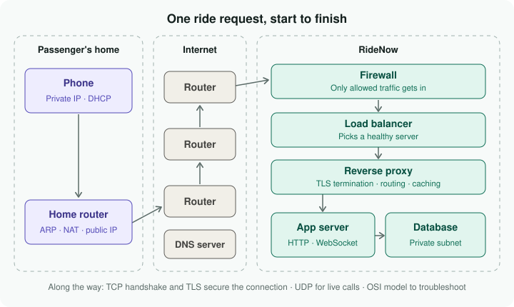

# Networking Bench

Study kit for networking basics, built around one idea: follow a single request (a passenger tapping **Request Ride** in a rideshare app) from the phone, across the internet, and into the company's servers. Each of the 20 topics solves one problem along that trip.

Made for CompTIA A+ prep, with a head start on Network+ and CCNA.

## What's inside

| File | What it is |
| --- | --- |
| `index.html` | **Networking Bench** practice test. 73 questions, a new random mix every round, answer choices shuffled. |
| `flashcards.html` | **Networking Flashcards**. 42 flip cards with "Got it" and "Still learning" piles. |
| `journey.html` | **Ride Request Journey**. Click through the trip one step at a time and watch the request move across the map. |
| `journey.svg` | The trip as a picture, shown in the notes and this README. |
| `NOTES.md` | Full study notes: all 20 steps, the trip start to finish, and a cheat sheet of ports, Windows commands and troubleshooting clues. |

## Practice test features

- Choose **10, 20 or 30** questions per round
- **Timer** (1 minute per question, real exam pace) or no timer
- Focus on one part of the trip or all four: Home, Getting there, Connection, Servers
- Set your passing score (70, 80 or 90%)
- Explains **why every answer choice** is right or wrong
- Results show **strong and weak topics**, a review of missed questions, and **Retry only what I missed**
- Keeps your last 8 attempts in the browser

## Flashcard features

- Filter by part of the trip, or study just the **port numbers**
- Shuffle, flip, and sort cards into **Got it** or **Still learning**
- Study only the **Still learning** pile
- Keyboard: `Space` flip · `←` `→` move · `K` got it · `L` still learning

## Using it

Both pages are single HTML files with no install. Download the repo and double-click `index.html` or `flashcards.html` to open it in your browser.

### Put it online with GitHub Pages (free)

1. In the repo, go to **Settings → Pages**.
2. Under **Build and deployment**, set **Source** to **Deploy from a branch**.
3. Pick the **main** branch and the **/ (root)** folder, then **Save**.
4. After a minute or two, the page shows your link, like `https://<your-username>.github.io/networking-bench/`.
   - Practice test: that link
   - Flashcards: add `flashcards.html` to the end
   - Step-by-step journey: add `journey.html` to the end

## Topics covered

1. IP addresses (IPv4 / IPv6)
2. Private vs public IPs
3. DNS
4. Ports
5. MAC addresses
6. ARP
7. Routing
8. NAT
9. Subnetting
10. DHCP
11. TCP
12. Three-way handshake
13. HTTPS and TLS
14. HTTP
15. Load balancers
16. Reverse proxies
17. Firewalls
18. WebSockets
19. UDP
20. The OSI model and bottom-up troubleshooting

## Credit

The rideshare story follows the Cloud X Berry YouTube video [I Bet Nobody Has Ever Explained the Networking Topics Like This Before](https://www.youtube.com/watch?v=TR0RU2pmMeA) (Oct 13, 2026). Notes, questions and flashcards are original study material.
